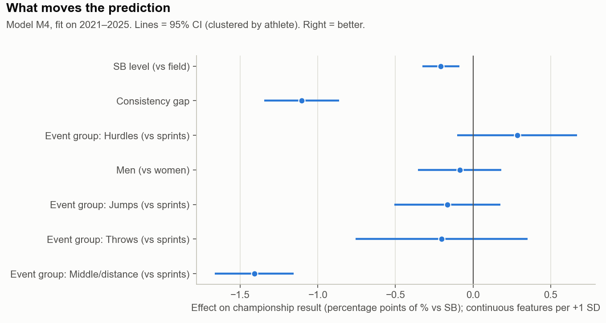
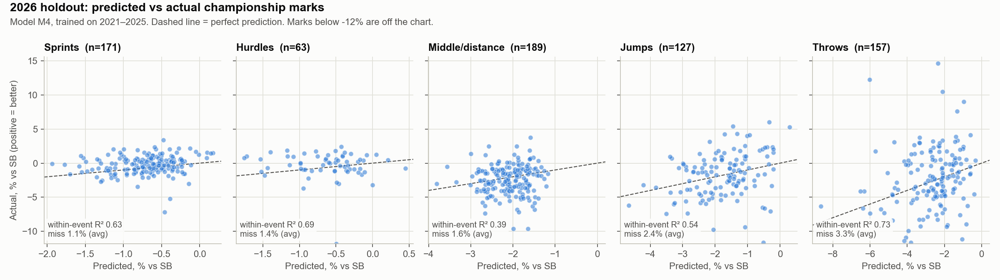
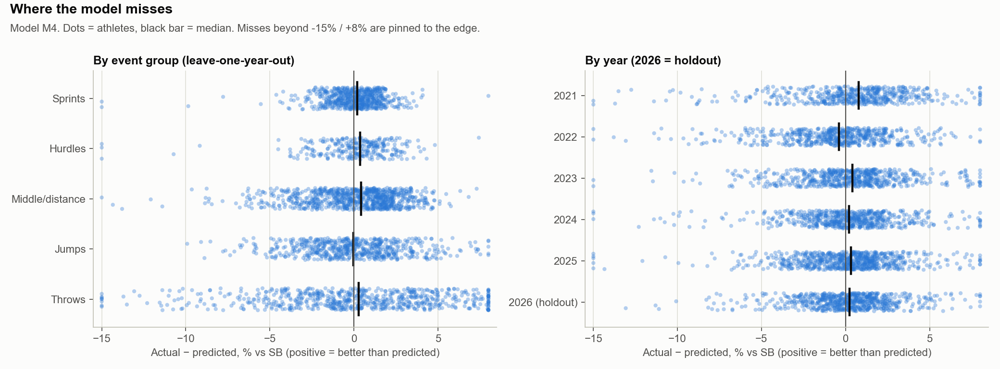
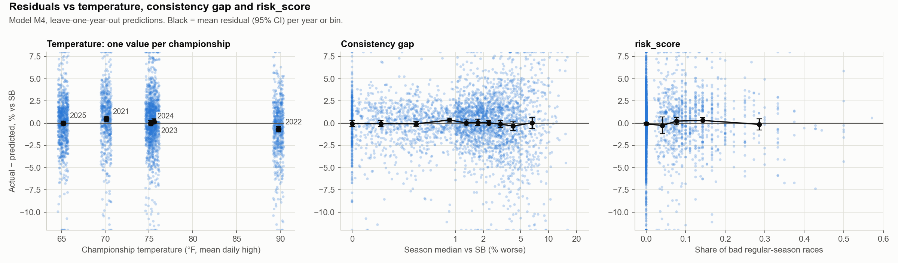

# Big West Championships mark prediction: train 2021–2025, test 2026

Generated by `modeling/model_bigwest.py` (base metric: **SB**). Rerun the script to regenerate every number, table and figure.

## Bottom line

- **Chosen model: M4** (Event group, Gender, SB level (vs field), Consistency gap). On the 2026 holdout it explains **61%** of the differences between athletes in the same event (pooled within-event R²), vs 36% for SB as-is and 46% for SB minus the average drop-off. Typical miss: 2.0% of the mark. Expect closer to 50% in a typical year (the LOYO average).
- **Most of that R² is the SB itself.** Of the variation in how far athletes finish above or below their SB, the model explains 8% (LOYO) and 10% (2026). The strongest signal is consistency: athletes whose season median sits far behind their SB fall further short of it.
- **Where the gain over "SB as-is" comes from (LOYO sRMSE 1.310 → 1.147):** 67% from applying the average drop-off (Baseline B, 1.200) and 33% from the athlete/event features on top.
- **risk_score:** no significant effect (+0.10 percentage points per +0.10, 95% CI -0.07 to +0.28).
- **Temperature:** -0.28% per +10°F at the year level (95% CI -0.70 to +0.14), from only 5 championships — not distinguishable from zero, and it comes entirely from 2022 (without 2022: +0.03%). Adding it does not lower out-of-sample error.

## Assumptions

- **Data:** `data/processed/bigwest_2021_2026_results.csv` (championship marks, one row per athlete-event) and `regular_season.csv`. Relays and multi-events are excluded (no individual season best on the same scale).
- **Column names:** the prompt's `temperature` is the `temp` column: the mean daily high (°F, Open-Meteo, city-level) over the championship's main-meet days. 2026 was corrected to **May 15–16** (TFRRS lists May 8–16 because it folds in the multi-events weekend; Big West athletes raced at Titan Tune Up on May 8). That moved 2026 from 69.9°F to 68.1°F in the CSV. 2021 uses TFRRS's May 12–15 (dropping May 12 would give 69.5°F instead of 70.1°F).
- **risk_score:** rebuilt inside the script, not read from the CSV column: same rules as `notebooks/risk_score.ipynb` (DQ/FS, DNF, FOUL/NH/NM, and outlier marks beyond Q3 + 3·IQR of % off the athlete's SB for the event — not a fixed 50% rule), but using only races before that year's Big West and outlier cutoffs from 2021–2025 only. Correlation with the CSV column: 0.996 (100% of athlete-seasons identical to 4 decimals). It covers indoor and outdoor races.
- **SB and median:** outdoor marks before the championship (one best mark per meet), all winds, as in the earlier single-feature work.
- **SB level** (added in M3): the athlete's SB as a z-score among that year's championship entrants in the event (positive = better). It lets the model learn that the best seeds drop off differently from the rest — the relative-scale version of a fitted slope. Entry lists are known before the meet, so it isn't leakage.
- **Consistency gap** = how far the season median is behind the SB, in % (≥ 0; bigger = less consistent).
- **Target:** `perf_pct` = championship mark vs SB in %, positive = better (track (SB − mark)/SB, field (mark − SB)/SB). Marks more than 50% worse than SB are dropped from training.
- **Errors** are always *actual − predicted* in % vs SB, so a negative bias means athletes did worse than predicted. **sRMSE** (selection metric) = root-mean-square error after dividing each miss by its event's training-year SD of % vs SB, so a 100m and a javelin count equally.
- **Within-event R²** is computed on marks (predictions converted back), per event-year with ≥ 5 athletes. "Mean" averages events equally; "pooled" weights by athletes and matches the earlier 2021→2022 figure (~0.46).

## Step 0: data checks

**Rows from championship entry to model** (individual track and field events):

|   year |   Individual championship entries |   With a mark |   Also have regular-season marks in the event |   Dropped: >50% off SB |   Modeled |
|-------:|----------------------------------:|--------------:|----------------------------------------------:|-----------------------:|----------:|
|   2021 |                               597 |           581 |                                           537 |                      1 |       536 |
|   2022 |                               649 |           615 |                                           594 |                      1 |       593 |
|   2023 |                               678 |           663 |                                           633 |                      1 |       632 |
|   2024 |                               686 |           661 |                                           626 |                      3 |       623 |
|   2025 |                               830 |           790 |                                           763 |                      0 |       763 |
|   2026 |                               790 |           754 |                                           707 |                      0 |       707 |

**Modeled rows by year, event group and gender:**

|   year |   Sprints |   Hurdles |   Middle/distance |   Jumps |   Throws |   women |   men |   Total |
|-------:|----------:|----------:|------------------:|--------:|---------:|--------:|------:|--------:|
|   2021 |        87 |        51 |               141 |     117 |      140 |     279 |   257 |     536 |
|   2022 |       124 |        50 |               177 |     117 |      125 |     315 |   278 |     593 |
|   2023 |       126 |        60 |               172 |     127 |      147 |     328 |   304 |     632 |
|   2024 |       131 |        59 |               192 |     113 |      128 |     330 |   293 |     623 |
|   2025 |       182 |        68 |               210 |     159 |      144 |     399 |   364 |     763 |
|   2026 |       171 |        63 |               189 |     127 |      157 |     393 |   314 |     707 |

Per-event counts are in `tables/rows_by_event.csv`. Smallest event-years: men 10,000 2021 (3), men 10,000 2024 (3), men 10,000 2026 (3), women 10,000 2021 (5).

**Temperature is one value per championship.** It does not vary by day, session or event within a year, so its effect rests on 5 training data points (4 inside any CV fold):

|   year | Main-meet dates   | City            |   Distinct temp values |   temp (°F) |
|-------:|:------------------|:----------------|-----------------------:|------------:|
|   2021 | May 12-15, 2021   | Irvine          |                      1 |        70.1 |
|   2022 | May 13-14, 2022   | Davis           |                      1 |        89.8 |
|   2023 | May 12-13, 2023   | Fullerton       |                      1 |        75.6 |
|   2024 | May 10-11, 2024   | San Luis Obispo |                      1 |        75.2 |
|   2025 | May 16-17, 2025   | Long Beach      |                      1 |        65.2 |
|   2026 | May 15-16, 2026   | Long Beach      |                      1 |        68.1 |

**risk_score by year** (one row per athlete-season in the model):

|   year |   athletes |   mean |   median |   p90 |   share_zero |   median_starts |
|-------:|-----------:|-------:|---------:|------:|-------------:|----------------:|
|   2021 |        364 |  0.036 |    0.000 | 0.143 |        0.810 |           7.000 |
|   2022 |        427 |  0.032 |    0.000 | 0.128 |        0.726 |           9.000 |
|   2023 |        439 |  0.037 |    0.000 | 0.126 |        0.688 |          11.000 |
|   2024 |        447 |  0.044 |    0.000 | 0.143 |        0.680 |          10.000 |
|   2025 |        533 |  0.037 |    0.000 | 0.136 |        0.715 |          10.000 |
|   2026 |        516 |  0.038 |    0.000 | 0.143 |        0.727 |          10.000 |

**No leakage:** every feature uses only races that started before that year's Big West:

|   year | Championship starts   | Latest meet in SB/median features   | Latest race in risk_score   |
|-------:|:----------------------|:------------------------------------|:----------------------------|
|   2021 | 2021-05-12            | 2021-05-01                          | 2021-05-01                  |
|   2022 | 2022-05-13            | 2022-05-07                          | 2022-05-07                  |
|   2023 | 2023-05-12            | 2023-05-06                          | 2023-05-06                  |
|   2024 | 2024-05-10            | 2024-05-04                          | 2024-05-04                  |
|   2025 | 2025-05-16            | 2025-05-09                          | 2025-05-09                  |
|   2026 | 2026-05-15            | 2026-05-08                          | 2026-05-08                  |

**Repeat athletes:** 802 of 1461 athletes appear in more than one year (463 in 2 years, 215 in 3 years, 124 in 4 years). 58% of 2026 athletes also appear in training years, so the holdout is new races, not entirely new people. Coefficient CIs are clustered by athlete for this reason.

## Model comparison

Ladder: each row adds to the one above. The selection metric is **sRMSE** (lower = better). The year columns are the held-out year.

### Leave-one-year-out (train on 4 years, validate on the 5th)

|                                                           |   2021 |   2022 |   2023 |   2024 |   2025 |   mean |   fold SD |   within-event R² (mean) |   within-event R² (pooled) |   R² on % vs SB |   MAE % |   MAE track (s) |   MAE field (m) |   bias % |
|:----------------------------------------------------------|-------:|-------:|-------:|-------:|-------:|-------:|----------:|-------------------------:|---------------------------:|----------------:|--------:|----------------:|----------------:|---------:|
| A: Baseline A: mark = SB                                  |  1.116 |  1.302 |  1.119 |  1.414 |  1.597 |  1.310 |     0.205 |                    0.277 |                      0.285 |          -0.240 |   2.706 |           9.322 |           1.061 |   -1.743 |
| B: Baseline B: SB + average drop-off                      |  1.105 |  1.071 |  1.014 |  1.330 |  1.481 |  1.200 |     0.198 |                    0.422 |                      0.427 |          -0.012 |   2.503 |           7.698 |           0.967 |    0.002 |
| M3a: Event group + gender                                 |  1.069 |  1.058 |  0.962 |  1.285 |  1.468 |  1.169 |     0.205 |                    0.468 |                      0.479 |           0.018 |   2.416 |           7.640 |           0.964 |    0.009 |
| M3: + SB level                                            |  1.064 |  1.074 |  0.959 |  1.276 |  1.475 |  1.170 |     0.206 |                    0.477 |                      0.486 |           0.020 |   2.431 |           7.550 |           0.968 |    0.009 |
| M4: + consistency gap                                     |  1.046 |  1.048 |  0.933 |  1.257 |  1.450 |  1.147 |     0.206 |                    0.491 |                      0.502 |           0.075 |   2.348 |           7.510 |           0.930 |    0.007 |
| M5: + risk_score + n_starts                               |  1.043 |  1.049 |  0.934 |  1.258 |  1.450 |  1.147 |     0.206 |                    0.491 |                      0.501 |           0.076 |   2.350 |           7.496 |           0.931 |    0.008 |
| M6: + temperature                                         |  1.036 |  1.055 |  0.934 |  1.258 |  1.482 |  1.153 |     0.218 |                    0.491 |                      0.499 |           0.070 |   2.346 |           7.472 |           0.932 |   -0.138 |
| M6x: + temperature × event group                          |  1.041 |  1.056 |  0.935 |  1.258 |  1.461 |  1.150 |     0.210 |                    0.489 |                      0.496 |           0.068 |   2.353 |           7.481 |           0.934 |   -0.134 |
| M3a [SD-scaled]: Event group + gender                     |  1.058 |  1.067 |  0.956 |  1.288 |  1.470 |  1.168 |     0.208 |                    0.474 |                      0.478 |           0.008 |   2.426 |           7.786 |           0.974 |    0.027 |
| M3 [SD-scaled]: + SB level                                |  1.050 |  1.078 |  0.953 |  1.281 |  1.470 |  1.166 |     0.208 |                    0.483 |                      0.485 |           0.009 |   2.437 |           7.710 |           0.981 |    0.027 |
| M4 [SD-scaled]: + consistency gap                         |  1.035 |  1.054 |  0.936 |  1.262 |  1.453 |  1.148 |     0.208 |                    0.496 |                      0.500 |           0.046 |   2.377 |           7.616 |           0.963 |    0.044 |
| M5 [SD-scaled]: + risk_score + n_starts                   |  1.033 |  1.053 |  0.936 |  1.261 |  1.453 |  1.147 |     0.208 |                    0.497 |                      0.500 |           0.047 |   2.376 |           7.594 |           0.963 |    0.044 |
| M6 [SD-scaled]: + temperature                             |  1.028 |  1.050 |  0.936 |  1.261 |  1.469 |  1.149 |     0.215 |                    0.501 |                      0.502 |           0.047 |   2.369 |           7.516 |           0.963 |   -0.076 |
| M6x [SD-scaled]: + temperature × event group              |  1.032 |  1.051 |  0.937 |  1.261 |  1.468 |  1.150 |     0.213 |                    0.501 |                      0.499 |           0.043 |   2.371 |           7.513 |           0.964 |   -0.090 |
| M6 [track/field]: + temperature                           |  1.044 |  1.057 |  0.973 |  1.282 |  1.472 |  1.166 |     0.207 |                    0.455 |                      0.460 |           0.049 |   2.390 |           7.763 |           0.931 |   -0.129 |
| M6x [track/field]: + temperature × event group            |  1.048 |  1.059 |  0.973 |  1.282 |  1.467 |  1.166 |     0.204 |                    0.452 |                      0.459 |           0.050 |   2.392 |           7.779 |           0.931 |   -0.129 |
| M6 [smoothed risk k=3]: + temperature                     |  1.035 |  1.055 |  0.933 |  1.258 |  1.481 |  1.153 |     0.218 |                    0.491 |                      0.499 |           0.070 |   2.346 |           7.468 |           0.932 |   -0.137 |
| M6 [smoothed risk k=5]: + temperature                     |  1.035 |  1.055 |  0.933 |  1.258 |  1.481 |  1.153 |     0.218 |                    0.491 |                      0.499 |           0.070 |   2.346 |           7.467 |           0.932 |   -0.137 |
| M6 [smoothed risk k=10]: + temperature                    |  1.035 |  1.055 |  0.933 |  1.258 |  1.481 |  1.152 |     0.218 |                    0.492 |                      0.500 |           0.070 |   2.346 |           7.465 |           0.932 |   -0.137 |
| M6 [SD-scaled, track/field]: + temperature                |  1.029 |  1.062 |  0.971 |  1.273 |  1.479 |  1.163 |     0.210 |                    0.464 |                      0.466 |           0.012 |   2.439 |           7.634 |           0.975 |   -0.026 |
| M6x [SD-scaled, track/field]: + temperature × event group |  1.029 |  1.061 |  0.971 |  1.273 |  1.481 |  1.163 |     0.211 |                    0.466 |                      0.466 |           0.011 |   2.440 |           7.609 |           0.976 |   -0.025 |
| M6 [SD-scaled, smoothed risk k=3]: + temperature          |  1.028 |  1.050 |  0.936 |  1.260 |  1.469 |  1.149 |     0.215 |                    0.502 |                      0.502 |           0.047 |   2.369 |           7.512 |           0.963 |   -0.075 |
| M6 [SD-scaled, smoothed risk k=5]: + temperature          |  1.028 |  1.050 |  0.936 |  1.260 |  1.469 |  1.149 |     0.215 |                    0.502 |                      0.502 |           0.047 |   2.369 |           7.511 |           0.963 |   -0.074 |
| M6 [SD-scaled, smoothed risk k=10]: + temperature         |  1.028 |  1.050 |  0.935 |  1.260 |  1.469 |  1.148 |     0.215 |                    0.502 |                      0.502 |           0.047 |   2.369 |           7.510 |           0.963 |   -0.074 |
| M4 [mixed]: + consistency gap                             |  1.028 |  1.041 |  0.910 |  1.257 |  1.454 |  1.138 |     0.216 |                    0.508 |                      0.519 |           0.082 |   2.326 |           7.371 |           0.933 |    0.009 |
| M4 [mixed + slope]: + consistency gap                     |  1.035 |  1.043 |  0.906 |  1.250 |  1.458 |  1.138 |     0.217 |                    0.510 |                      0.519 |           0.078 |   2.338 |           7.356 |           0.940 |    0.009 |
| M4 [gap_pct²]: + consistency gap                          |  1.049 |  1.049 |  0.928 |  1.259 |  1.449 |  1.147 |     0.207 |                    0.490 |                      0.502 |           0.077 |   2.346 |           7.541 |           0.928 |    0.006 |

### Forward-chaining (train on earlier years only)

|                                                           |   2023 |   2024 |   2025 |   mean |   fold SD |   within-event R² (mean) |   within-event R² (pooled) |   R² on % vs SB |   MAE % |   MAE track (s) |   MAE field (m) |   bias % |
|:----------------------------------------------------------|-------:|-------:|-------:|-------:|----------:|-------------------------:|---------------------------:|----------------:|--------:|----------------:|----------------:|---------:|
| A: Baseline A: mark = SB                                  |  1.196 |  1.419 |  1.597 |  1.404 |     0.201 |                    0.326 |                      0.263 |          -0.221 |   2.626 |           8.599 |           1.005 |   -1.671 |
| B: Baseline B: SB + average drop-off                      |  1.154 |  1.359 |  1.481 |  1.332 |     0.165 |                    0.445 |                      0.405 |          -0.002 |   2.460 |           6.908 |           0.921 |    0.139 |
| M3a: Event group + gender                                 |  1.054 |  1.291 |  1.468 |  1.271 |     0.208 |                    0.497 |                      0.472 |           0.021 |   2.349 |           6.890 |           0.932 |    0.096 |
| M3: + SB level                                            |  1.060 |  1.281 |  1.475 |  1.272 |     0.208 |                    0.510 |                      0.486 |           0.025 |   2.353 |           6.751 |           0.936 |    0.095 |
| M4: + consistency gap                                     |  1.050 |  1.253 |  1.450 |  1.251 |     0.200 |                    0.537 |                      0.507 |           0.078 |   2.252 |           6.580 |           0.899 |    0.089 |
| M5: + risk_score + n_starts                               |  1.065 |  1.255 |  1.450 |  1.256 |     0.193 |                    0.533 |                      0.503 |           0.073 |   2.269 |           6.562 |           0.906 |    0.137 |
| M6: + temperature                                         |  1.049 |  1.253 |  1.482 |  1.261 |     0.217 |                    0.535 |                      0.500 |           0.069 |   2.247 |           6.579 |           0.900 |   -0.218 |
| M6x: + temperature × event group                          |  1.051 |  1.253 |  1.461 |  1.255 |     0.205 |                    0.533 |                      0.495 |           0.070 |   2.252 |           6.608 |           0.902 |   -0.195 |
| M3a [SD-scaled]: Event group + gender                     |  1.048 |  1.291 |  1.470 |  1.270 |     0.212 |                    0.493 |                      0.474 |           0.013 |   2.358 |           6.981 |           0.942 |    0.124 |
| M3 [SD-scaled]: + SB level                                |  1.047 |  1.286 |  1.470 |  1.268 |     0.212 |                    0.502 |                      0.484 |           0.016 |   2.355 |           6.884 |           0.946 |    0.123 |
| M4 [SD-scaled]: + consistency gap                         |  1.030 |  1.265 |  1.453 |  1.250 |     0.212 |                    0.525 |                      0.503 |           0.050 |   2.277 |           6.720 |           0.916 |    0.147 |
| M5 [SD-scaled]: + risk_score + n_starts                   |  1.037 |  1.265 |  1.453 |  1.251 |     0.208 |                    0.523 |                      0.502 |           0.043 |   2.289 |           6.691 |           0.925 |    0.193 |
| M6 [SD-scaled]: + temperature                             |  1.030 |  1.265 |  1.469 |  1.254 |     0.220 |                    0.527 |                      0.501 |           0.054 |   2.262 |           6.642 |           0.907 |   -0.136 |
| M6x [SD-scaled]: + temperature × event group              |  1.035 |  1.265 |  1.468 |  1.256 |     0.216 |                    0.525 |                      0.496 |           0.049 |   2.264 |           6.655 |           0.911 |   -0.122 |
| M6 [track/field]: + temperature                           |  1.080 |  1.282 |  1.472 |  1.278 |     0.196 |                    0.495 |                      0.443 |           0.048 |   2.297 |           7.024 |           0.891 |   -0.276 |
| M6x [track/field]: + temperature × event group            |  1.080 |  1.284 |  1.467 |  1.277 |     0.193 |                    0.496 |                      0.445 |           0.049 |   2.301 |           6.970 |           0.893 |   -0.270 |
| M6 [smoothed risk k=3]: + temperature                     |  1.049 |  1.253 |  1.481 |  1.261 |     0.216 |                    0.535 |                      0.500 |           0.069 |   2.247 |           6.580 |           0.900 |   -0.218 |
| M6 [smoothed risk k=5]: + temperature                     |  1.049 |  1.253 |  1.481 |  1.261 |     0.216 |                    0.535 |                      0.500 |           0.069 |   2.248 |           6.580 |           0.900 |   -0.218 |
| M6 [smoothed risk k=10]: + temperature                    |  1.049 |  1.253 |  1.481 |  1.261 |     0.216 |                    0.535 |                      0.500 |           0.069 |   2.248 |           6.582 |           0.901 |   -0.217 |
| M6 [SD-scaled, track/field]: + temperature                |  1.041 |  1.277 |  1.479 |  1.266 |     0.219 |                    0.505 |                      0.470 |           0.029 |   2.308 |           6.733 |           0.911 |   -0.218 |
| M6x [SD-scaled, track/field]: + temperature × event group |  1.043 |  1.277 |  1.481 |  1.267 |     0.220 |                    0.504 |                      0.468 |           0.025 |   2.307 |           6.760 |           0.915 |   -0.196 |
| M6 [SD-scaled, smoothed risk k=3]: + temperature          |  1.030 |  1.265 |  1.469 |  1.254 |     0.220 |                    0.527 |                      0.501 |           0.054 |   2.261 |           6.641 |           0.908 |   -0.136 |
| M6 [SD-scaled, smoothed risk k=5]: + temperature          |  1.030 |  1.265 |  1.469 |  1.254 |     0.220 |                    0.527 |                      0.501 |           0.054 |   2.261 |           6.641 |           0.908 |   -0.136 |
| M6 [SD-scaled, smoothed risk k=10]: + temperature         |  1.030 |  1.264 |  1.469 |  1.254 |     0.220 |                    0.527 |                      0.501 |           0.054 |   2.261 |           6.642 |           0.908 |   -0.136 |
| M4 [mixed]: + consistency gap                             |  1.043 |  1.248 |  1.454 |  1.248 |     0.206 |                    0.536 |                      0.521 |           0.075 |   2.240 |           6.575 |           0.912 |    0.092 |
| M4 [mixed + slope]: + consistency gap                     |  1.041 |  1.249 |  1.458 |  1.249 |     0.208 |                    0.534 |                      0.519 |           0.069 |   2.251 |           6.500 |           0.915 |    0.109 |
| M4 [gap_pct²]: + consistency gap                          |  1.043 |  1.254 |  1.449 |  1.248 |     0.203 |                    0.539 |                      0.508 |           0.081 |   2.247 |           6.567 |           0.896 |    0.087 |

### 2026 holdout (refit on 2021–2025, evaluated once)

| model         |   n |   sRMSE |   within-event R² (mean) |   within-event R² (pooled) |   R² on % vs SB |   MAE % |   MAE track (s) |   MAE field (m) |   bias % |
|:--------------|----:|--------:|-------------------------:|---------------------------:|----------------:|--------:|----------------:|----------------:|---------:|
| Baseline A: A | 707 |   1.059 |                    0.308 |                      0.357 |          -0.266 |   2.453 |           7.874 |           1.014 |   -1.557 |
| Baseline B: B | 707 |   0.989 |                    0.447 |                      0.458 |          -0.004 |   2.264 |           5.600 |           0.904 |    0.189 |
| Chosen: M4    | 707 |   0.853 |                    0.580 |                      0.606 |           0.100 |   1.989 |           5.318 |           0.867 |    0.133 |

### How the model was chosen

- LOYO: lowest error **M4 [mixed]: + consistency gap**; simplest within one fold-SD: **M4: + consistency gap**.
- Forward-chaining: lowest error **M4 [mixed]: + consistency gap**; simplest within one fold-SD: **M4: + consistency gap**.
- The LOYO pick's forward-chaining error vs its LOYO error on the same years: 2023: +12.5%, 2024: -0.3%, 2025: +0.0%. Not clearly worse, so the LOYO pick stands.
- **Chosen: M4: + consistency gap.**

Selection table (LOYO)

|                                                           |   mean_srmse |   diff_vs_best |   fold_sd_of_diff | within_1sd   |   parameters |
|:----------------------------------------------------------|-------------:|---------------:|------------------:|:-------------|-------------:|
| M4 [mixed]: + consistency gap                             |        1.138 |          0.000 |             0.000 | True         |            9 |
| M4 [mixed + slope]: + consistency gap                     |        1.138 |          0.000 |             0.006 | True         |           11 |
| M4: + consistency gap                                     |        1.147 |          0.009 |             0.011 | True         |            8 |
| M5: + risk_score + n_starts                               |        1.147 |          0.009 |             0.011 | True         |           10 |
| M4 [gap_pct²]: + consistency gap                          |        1.147 |          0.009 |             0.011 | True         |            9 |
| M5 [SD-scaled]: + risk_score + n_starts                   |        1.147 |          0.009 |             0.010 | True         |           10 |
| M4 [SD-scaled]: + consistency gap                         |        1.148 |          0.010 |             0.010 | True         |            8 |
| M6 [SD-scaled, smoothed risk k=10]: + temperature         |        1.148 |          0.010 |             0.010 | False        |           11 |
| M6 [SD-scaled, smoothed risk k=5]: + temperature          |        1.149 |          0.010 |             0.010 | False        |           11 |
| M6 [SD-scaled, smoothed risk k=3]: + temperature          |        1.149 |          0.011 |             0.010 | False        |           11 |
| M6 [SD-scaled]: + temperature                             |        1.149 |          0.011 |             0.010 | False        |           11 |
| M6x [SD-scaled]: + temperature × event group              |        1.150 |          0.012 |             0.010 | False        |           15 |
| M6x: + temperature × event group                          |        1.150 |          0.012 |             0.009 | False        |           15 |
| M6 [smoothed risk k=10]: + temperature                    |        1.152 |          0.014 |             0.011 | False        |           11 |
| M6 [smoothed risk k=5]: + temperature                     |        1.153 |          0.015 |             0.011 | False        |           11 |
| M6 [smoothed risk k=3]: + temperature                     |        1.153 |          0.015 |             0.011 | False        |           11 |
| M6: + temperature                                         |        1.153 |          0.015 |             0.011 | False        |           11 |
| M6 [SD-scaled, track/field]: + temperature                |        1.163 |          0.025 |             0.022 | False        |            8 |
| M6x [SD-scaled, track/field]: + temperature × event group |        1.163 |          0.025 |             0.022 | False        |            9 |
| M6x [track/field]: + temperature × event group            |        1.166 |          0.028 |             0.020 | False        |            9 |
| M6 [track/field]: + temperature                           |        1.166 |          0.028 |             0.020 | False        |            8 |
| M3 [SD-scaled]: + SB level                                |        1.166 |          0.028 |             0.011 | False        |            7 |
| M3a [SD-scaled]: Event group + gender                     |        1.168 |          0.030 |             0.011 | False        |            6 |
| M3a: Event group + gender                                 |        1.169 |          0.031 |             0.016 | False        |            6 |
| M3: + SB level                                            |        1.170 |          0.032 |             0.012 | False        |            7 |

## Chosen model: coefficients (fit on 2021–2025)

Target units: **percentage points** of % vs SB, positive = better. "per-SD coef" = effect of +1 SD of a continuous feature. CIs and p-values are clustered by athlete. VIF > 5 would flag collinearity.

|                                           |   coef |   95% CI low |   95% CI high |     p |   per-SD coef |   per-SD CI low |   per-SD CI high |     VIF |
|:------------------------------------------|-------:|-------------:|--------------:|------:|--------------:|----------------:|-----------------:|--------:|
| Intercept                                 | -0.182 |       -0.428 |         0.065 | 0.149 |        -1.254 |          -1.480 |           -1.028 | nan     |
| Event group: Hurdles (vs sprints)         |  0.284 |       -0.103 |         0.670 | 0.150 |         0.284 |          -0.103 |            0.670 |   1.319 |
| Event group: Middle/distance (vs sprints) | -1.409 |       -1.664 |        -1.155 | 0.000 |        -1.409 |          -1.664 |           -1.155 |   1.705 |
| Event group: Jumps (vs sprints)           | -0.165 |       -0.506 |         0.176 | 0.342 |        -0.165 |          -0.506 |            0.176 |   1.714 |
| Event group: Throws (vs sprints)          | -0.202 |       -0.756 |         0.352 | 0.475 |        -0.202 |          -0.756 |            0.352 |   2.229 |
| Men (vs women)                            | -0.086 |       -0.354 |         0.183 | 0.531 |        -0.086 |          -0.354 |            0.183 |   1.005 |
| SB level (vs field)                       | -0.213 |       -0.335 |        -0.090 | 0.001 |        -0.207 |          -0.327 |           -0.088 |   1.004 |
| Consistency gap                           | -0.492 |       -0.599 |        -0.384 | 0.000 |        -1.104 |          -1.345 |           -0.863 |   1.634 |

## By event group

### Leave-one-year-out (out-of-fold predictions, all 5 folds)

| group           |   n |   sRMSE A |   sRMSE B |   sRMSE chosen |   MAE % chosen |   MAE s/m chosen |   bias % chosen |   R² A |   R² chosen | worse than A?   |
|:----------------|----:|----------:|----------:|---------------:|---------------:|-----------------:|----------------:|-------:|------------:|:----------------|
| Sprints         | 650 |     1.358 |     1.407 |          1.269 |          1.209 |            0.339 |           0.009 |  0.497 |       0.575 |                 |
| Hurdles         | 288 |     1.866 |     1.802 |          1.827 |          1.722 |            0.592 |          -0.014 |  0.618 |       0.606 |                 |
| Middle/distance | 892 |     1.350 |     1.088 |          1.087 |          2.122 |           14.737 |          -0.009 | -0.304 |       0.178 |                 |
| Jumps           | 633 |     1.180 |     1.050 |          0.972 |          2.249 |            0.138 |           0.001 |  0.388 |       0.599 |                 |
| Throws          | 684 |     1.177 |     1.070 |          1.022 |          4.006 |            1.654 |           0.012 |  0.524 |       0.639 |                 |

### 2026 holdout

| group           |   n |   sRMSE A |   sRMSE B |   sRMSE chosen |   MAE % chosen |   MAE s/m chosen |   bias % chosen |   R² A |   R² chosen | worse than A?   |
|:----------------|----:|----------:|----------:|---------------:|---------------:|-----------------:|----------------:|-------:|------------:|:----------------|
| Sprints         | 171 |     0.741 |     1.174 |          0.768 |          1.079 |            0.285 |           0.471 |  0.656 |       0.634 | yes             |
| Hurdles         |  63 |     0.902 |     1.021 |          0.929 |          1.390 |            0.486 |           0.300 |  0.720 |       0.688 | yes             |
| Middle/distance | 189 |     1.344 |     0.872 |          0.840 |          1.645 |           11.482 |          -0.357 | -0.418 |       0.392 |                 |
| Jumps           | 127 |     1.132 |     1.033 |          0.966 |          2.422 |            0.161 |           0.063 |  0.326 |       0.544 |                 |
| Throws          | 157 |     0.955 |     0.838 |          0.826 |          3.282 |            1.438 |           0.343 |  0.639 |       0.733 |                 |

### Track vs field

|             |    n |   sRMSE A |   sRMSE B |   sRMSE chosen |   MAE % chosen |   MAE s/m chosen |   bias % chosen |   R² A |   R² chosen | worse than A?   |
|:------------|-----:|----------:|----------:|---------------:|---------------:|-----------------:|----------------:|-------:|------------:|:----------------|
| LOYO: field | 1317 |     1.179 |     1.061 |          0.998 |          3.162 |            0.925 |           0.007 |  0.456 |       0.619 |                 |
| LOYO: track | 1830 |     1.446 |     1.338 |          1.294 |          1.735 |            7.397 |          -0.003 |  0.129 |       0.386 |                 |
| 2026: field |  284 |     1.038 |     0.930 |          0.892 |          2.898 |            0.867 |           0.218 |  0.482 |       0.638 |                 |
| 2026: track |  423 |     1.073 |     1.026 |          0.826 |          1.378 |            5.318 |           0.075 |  0.161 |       0.531 |                 |

Groups where the chosen model is worse than SB as-is: LOYO none; 2026 Sprints, Hurdles.
In 2026 these athletes finished closer to their SB than in the training years (bias sprints +0.47%, hurdles +0.30%), so the average drop-off the model subtracts was too pessimistic and SB as-is happened to be the better guess. Their training-year drop-off is under 1%, so the two are close either way.

## Bias by held-out year

Mean of actual − predicted (% vs SB). Negative = athletes did worse than the model expected.

|                |      A |      B |      M5 |      M6 |     M6x |     M4 |
|:---------------|-------:|-------:|--------:|--------:|--------:|-------:|
| 2021           | -1.348 |  0.479 |   0.410 |   0.287 |   0.267 |  0.483 |
| 2022           | -2.354 | -0.750 |  -0.657 |  -0.730 |  -0.724 | -0.672 |
| 2023           | -1.639 |  0.134 |   0.274 |   0.297 |   0.296 |  0.226 |
| 2024           | -1.685 |  0.076 |  -0.002 |   0.013 |   0.011 | -0.005 |
| 2025           | -1.690 |  0.074 |   0.014 |  -0.557 |  -0.522 |  0.004 |
| 2026 (holdout) | -1.557 |  0.189 | nan     | nan     | nan     |  0.133 |

In the hot 2022 fold (89.8°F), the model without temperature (M5) is off by -0.66%; adding temperature (M6) gives -0.73%, and temperature × event group (M6x) -0.72%. In this fold the temperature slope is learned from four championships between 65 and 76°F and then extrapolated to 89.8°F.
**Temperature does not reduce the 2022 bias out of sample:** without 2022, the other four championships show no temperature trend (+0.03% per +10°F), so there is nothing to extrapolate. It also adds bias in 2025, the coolest meet (+0.01% → -0.56%), because the slope learned with 2022 included predicts a cool meet should go better than it did.

## Nonlinearity check

Squared terms added to M4 (LOYO sRMSE):

|                                  |   mean |   fold SD |
|:---------------------------------|-------:|----------:|
| M4: + consistency gap            |  1.147 |     0.206 |
| M4 [gap_pct²]: + consistency gap |  1.147 |     0.207 |

The squared term did not beat the selection rule, so the model stays linear. Temperature has only 5 distinct values, so a curve in temperature can't be estimated.

## Sensitivity checks

**Excluding 2021 (COVID season):** LOYO over 2022–2025 only. Chosen under this scheme: **M4: + consistency gap**.

|                                              |   LOYO incl. 2021 (2022–25 folds) |   LOYO excl. 2021 |   change |
|:---------------------------------------------|----------------------------------:|------------------:|---------:|
| A: Baseline A: mark = SB                     |                             1.358 |             1.383 |    0.025 |
| B: Baseline B: SB + average drop-off         |                             1.224 |             1.246 |    0.022 |
| M3a: Event group + gender                    |                             1.193 |             1.213 |    0.020 |
| M3: + SB level                               |                             1.196 |             1.214 |    0.019 |
| M4: + consistency gap                        |                             1.172 |             1.190 |    0.018 |
| M5: + risk_score + n_starts                  |                             1.173 |             1.191 |    0.018 |
| M6: + temperature                            |                             1.182 |             1.203 |    0.021 |
| M6x: + temperature × event group             |                             1.177 |             1.195 |    0.018 |
| M3a [SD-scaled]: Event group + gender        |                             1.195 |             1.214 |    0.019 |
| M3 [SD-scaled]: + SB level                   |                             1.196 |             1.214 |    0.019 |
| M4 [SD-scaled]: + consistency gap            |                             1.176 |             1.194 |    0.018 |
| M5 [SD-scaled]: + risk_score + n_starts      |                             1.176 |             1.194 |    0.018 |
| M6 [SD-scaled]: + temperature                |                             1.179 |             1.199 |    0.020 |
| M6x [SD-scaled]: + temperature × event group |                             1.179 |             1.198 |    0.019 |

**2026 with and without the 50% filter** (the filter uses the outcome, so the unfiltered row is the honest worst case):

No 2026 mark was more than 50% off SB, so the filter changes nothing on the holdout (both versions score identically).

## Influence analysis

Full main-effects model (M6) fit on 2021–2025:

**By standardized coefficient** (effect of +1 SD, clustered CIs):

| Feature             |   per-SD coef | 95% CI           |     p |
|:--------------------|--------------:|:-----------------|------:|
| Consistency gap     |        -1.100 | [-1.340, -0.861] | 0.000 |
| Temperature         |        -0.214 | [-0.332, -0.096] | 0.000 |
| SB level (vs field) |        -0.202 | [-0.323, -0.082] | 0.001 |
| n_starts            |        -0.120 | [-0.296, 0.056]  | 0.180 |
| risk_score          |         0.075 | [-0.053, 0.202]  | 0.251 |

**By drop-one increase in LOYO sRMSE** (positive = the model is worse without it):

| Feature dropped     |   LOYO sRMSE increase |   fold SD | Folds where dropping hurts   |
|:--------------------|----------------------:|----------:|:-----------------------------|
| Consistency gap     |                0.0238 |    0.0063 | 5/5                          |
| Event group         |                0.0121 |    0.0160 | 4/5                          |
| risk_score          |                0.0002 |    0.0010 | 3/5                          |
| n_starts            |                0.0000 |    0.0020 | 2/5                          |
| Gender              |               -0.0008 |    0.0034 | 3/5                          |
| SB level (vs field) |               -0.0011 |    0.0071 | 3/5                          |
| Temperature         |               -0.0061 |    0.0152 | 2/5                          |

### (a) Does risk_score hurt championship performance?

| risk_score version   |   coef per +0.10 |   CI low |   CI high |     p |   per +1 SD |   per-SD CI low |   per-SD CI high |   LOYO sRMSE (M6) |
|:---------------------|-----------------:|---------:|----------:|------:|------------:|----------------:|-----------------:|------------------:|
| raw                  |            0.104 |   -0.073 |     0.280 | 0.251 |       0.075 |          -0.053 |            0.202 |             1.153 |
| smoothed k=3         |            0.166 |   -0.084 |     0.415 | 0.193 |       0.087 |          -0.044 |            0.217 |             1.153 |
| smoothed k=5         |            0.201 |   -0.092 |     0.495 | 0.178 |       0.091 |          -0.041 |            0.223 |             1.153 |
| smoothed k=10        |            0.285 |   -0.112 |     0.682 | 0.159 |       0.097 |          -0.038 |            0.231 |             1.152 |

No: with the raw rate, +0.10 risk_score (one extra bad race in ten) changes the result by +0.104 percentage points (95% CI -0.073 to +0.280, p = 0.25). The estimate is slightly positive, the opposite of the hypothesis. Smoothing does not change it: per SD the coefficient goes from +0.075 (raw) to +0.087 to +0.097 (smoothed), inside the raw CI. The per-0.10 coefficient grows only because smoothing squeezes risk_score toward the average. The raw version is kept for interpretability. LOYO error is the same for every version.

risk_score may matter more for *whether* an athlete gets a mark at all, which the mark model can't see. Among 2021–2025 championship entries, the no-mark rate (DNF/DQ/foul-out) is 2.4% for risk 0 (n=2281), 4.2% for risk 0–10% (n=518), 6.9% for risk >10% (n=463). Each +0.10 risk_score multiplies the odds of a championship no-mark by 1.45 (95% CI 1.23–1.71, logistic model with track/field, clustered by athlete).

### (b) Does temperature explain part of the drop-off?

Year-level check: mean residual of M5 (no temperature) for each championship vs its temperature:

|   year |   temp |   mean_resid |   n |
|-------:|-------:|-------------:|----:|
|   2021 |  70.10 |         0.34 | 536 |
|   2022 |  89.80 |        -0.53 | 593 |
|   2023 |  75.60 |         0.20 | 632 |
|   2024 |  75.20 |        -0.01 | 623 |
|   2025 |  65.20 |         0.01 | 763 |

- Slope: **-0.28% per +10°F** (95% CI -0.70 to +0.14, p = 0.12, 5 points, 3 degrees of freedom).
- Without 2022: +0.03% per +10°F (95% CI -1.01 to +1.07).
- The athlete-level OLS coefficient in M6 is -0.258 percentage points per +10°F with a naive CI of -0.405 to -0.112; that CI treats ~3147 rows as independent when temperature has only 5 values, so it is far too narrow. Use the year-level CI.
- Temperature is also confounded with everything else that changes by year (venue, track, 2021 COVID season, field depth). Treat it as a hypothesis with weak support, not a conclusion.

### (c) SB vs median as the base

|                                                           |   mean |   within-event R² (pooled) |   MAE % |   bias % |
|:----------------------------------------------------------|-------:|---------------------------:|--------:|---------:|
| A: Baseline A: mark = SB                                  |  1.310 |                      0.285 |   2.706 |   -1.743 |
| B: Baseline B: SB + average drop-off                      |  1.200 |                      0.427 |   2.503 |    0.002 |
| M3a: Event group + gender                                 |  1.169 |                      0.479 |   2.416 |    0.009 |
| M3: + SB level                                            |  1.170 |                      0.486 |   2.431 |    0.009 |
| M4: + consistency gap                                     |  1.147 |                      0.502 |   2.348 |    0.007 |
| M5: + risk_score + n_starts                               |  1.147 |                      0.501 |   2.350 |    0.008 |
| M6: + temperature                                         |  1.153 |                      0.499 |   2.346 |   -0.138 |
| M6x: + temperature × event group                          |  1.150 |                      0.496 |   2.353 |   -0.134 |
| M3a [SD-scaled]: Event group + gender                     |  1.168 |                      0.478 |   2.426 |    0.027 |
| M3 [SD-scaled]: + SB level                                |  1.166 |                      0.485 |   2.437 |    0.027 |
| M4 [SD-scaled]: + consistency gap                         |  1.148 |                      0.500 |   2.377 |    0.044 |
| M5 [SD-scaled]: + risk_score + n_starts                   |  1.147 |                      0.500 |   2.376 |    0.044 |
| M6 [SD-scaled]: + temperature                             |  1.149 |                      0.502 |   2.369 |   -0.076 |
| M6x [SD-scaled]: + temperature × event group              |  1.150 |                      0.499 |   2.371 |   -0.090 |
| A [median base]: Baseline A: mark = median                |  1.214 |                      0.372 |   2.545 |    0.438 |
| B [median base]: Baseline B: median + average drop-off    |  1.223 |                      0.353 |   2.521 |   -0.023 |
| M3a [median base]: Event group + gender                   |  1.182 |                      0.445 |   2.422 |   -0.003 |
| M3 [median base]: + SB level                              |  1.183 |                      0.448 |   2.430 |   -0.003 |
| M4 [median base]: + consistency gap                       |  1.146 |                      0.504 |   2.348 |    0.009 |
| M5 [median base]: + risk_score + n_starts                 |  1.146 |                      0.504 |   2.349 |    0.010 |
| M6 [median base]: + temperature                           |  1.152 |                      0.502 |   2.345 |   -0.138 |
| M6x [median base]: + temperature × event group            |  1.149 |                      0.499 |   2.353 |   -0.134 |
| M3a [median base, SD-scaled]: Event group + gender        |  1.177 |                      0.451 |   2.412 |   -0.062 |
| M3 [median base, SD-scaled]: + SB level                   |  1.178 |                      0.454 |   2.419 |   -0.063 |
| M4 [median base, SD-scaled]: + consistency gap            |  1.151 |                      0.497 |   2.367 |   -0.072 |
| M5 [median base, SD-scaled]: + risk_score + n_starts      |  1.151 |                      0.497 |   2.367 |   -0.069 |
| M6 [median base, SD-scaled]: + temperature                |  1.152 |                      0.497 |   2.360 |   -0.163 |
| M6x [median base, SD-scaled]: + temperature × event group |  1.152 |                      0.494 |   2.362 |   -0.176 |

Full model (M6) LOYO sRMSE: SB base 1.153 vs median base 1.152 (median − SB per fold: -0.001, -0.001, -0.003, -0.000, +0.001). The choice barely matters once the consistency gap is in the model, because SB + gap carries the same information as median + gap.

### (d) Does it transfer better than the 2021→2022 single-feature lines (~0.46)?

- LOYO 2022 fold (trained on the other four years): pooled within-event R² **0.49**.
- LOYO mean: 0.50; forward-chaining mean: 0.51; 2026 holdout: 0.61.
- 2026 was an easier year to predict than the CV years: even SB as-is scores 0.36 there vs 0.28 in LOYO. Use the LOYO mean as the expected accuracy for a new year.
- Yes, compared with ~0.46. Most of the improvement comes from training on several years and from the relative scale, which shares one drop-off across all events instead of fitting 37 separate lines.

### (e) Do LOYO and forward-chaining agree?

Yes: LOYO picks M4: + consistency gap, forward-chaining picks M4: + consistency gap. The LOYO pick's forward-chaining error differs from its LOYO error on the same years by 2023: +12.5%, 2024: -0.3%, 2025: +0.0%. The year-to-year swings in bias (table above) are larger than any steady trend.

## Plain-language summary for coaches

- **Expect athletes to finish about 1.7% worse than their season best at Big West.** That's the average over 2021–2025. It varies by event group: sprints -0.8%, hurdles -0.7%, middle/distance -2.1%, jumps -1.7%, throws -2.6%.

| Event              | Typical SB   | Average result vs SB   | Expected mark   |
|:-------------------|:-------------|:-----------------------|:----------------|
| Men's 100m         | 10.71        | -0.6%                  | 10.78           |
| Women's 400m       | 56.64        | -0.8%                  | 57.06           |
| Women's 1500m      | 4:36.67      | -2.4%                  | 4:43.34         |
| Men's 110m hurdles | 14.50        | -1.2%                  | 14.67           |
| Men's long jump    | 7.12m        | -1.5%                  | 7.01m           |
| Women's shot put   | 13.29m       | -2.5%                  | 12.96m          |

- **Rule of thumb from the model:** predict a mark about **49% of the way from the athlete's SB to their season median**. Consistent athletes stay close to their SB; streaky ones fall back toward their typical mark. Middle-distance and distance runners finish about another 1.4% slower than that (tactical championship races). Top seeds give back a little more: 0.2% per 1 SD of SB above the field.
- **Heat:** no reliable effect. The year-level estimate is -0.28% per +10°F, but the 95% CI (-0.70 to +0.14%) is wide because there are only 5 championships. The hot 2022 meet did have the biggest drop-off.
- **Risky athletes:** DQs, DNFs and no-marks in the regular season don't predict a worse *mark* at Big West (+0.10 risk_score ≈ +0.10 percentage points, not significant), but they do predict a higher chance of no mark at all (odds × 1.45 per +0.10).
- **How close are predictions?** On 2026, the typical miss was 2.0% of the mark (5.32 s on track, 0.87 m in the field). Field events, especially throws, are much less predictable than sprints.

## Files

- `predictions_2026.csv`: every 2026 athlete-event with SB, predicted and actual marks, error (actual − predicted, s or m) and the 50% filter flag.
- `chosen_model.pkl`: coefficients, spec, and the training-year SD and risk-rate tables. Load it with `spec, model, prep = load_model()` from `model_bigwest.py`, then `predict(spec, model, prep(rows))`.
- `tables/`: every model's per-fold metrics, holdout metrics, coefficients, row counts by event.
- `figures/`: the plots above.
